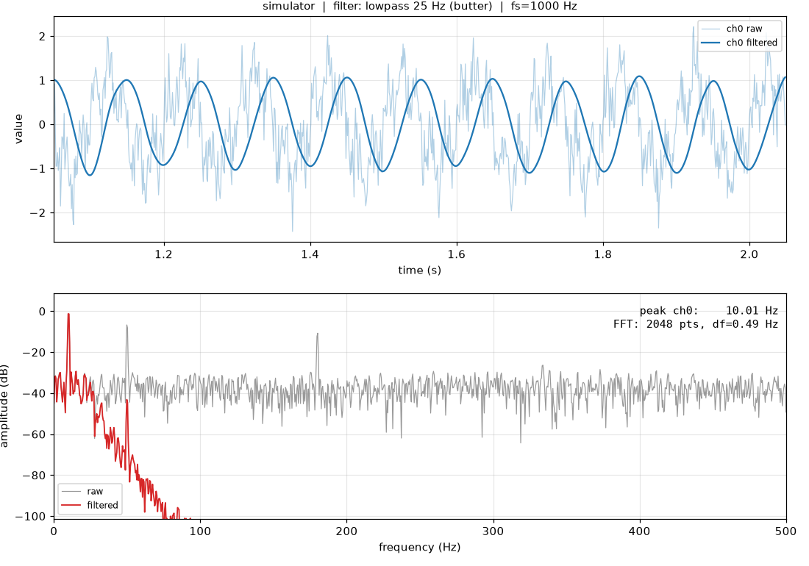

# uartscope: real-time serial plotter with FFT and digital filters

Plot data from a microcontroller (Arduino, ESP32, STM32, ...) in real time,
see its spectrum, clean it with a digital filter and record everything to CSV.
A built-in simulator and a virtual serial port let you try it without any hardware.



*Simulator: 10 Hz signal + 50 Hz and 180 Hz interference + noise, cleaned by a
6th-order Butterworth low-pass at 25 Hz. Top: raw vs filtered. Bottom: spectrum.*

## Features

- Reads text lines from any serial port: `1.23`, `1.23,4.56`, `a:1.2,b:3.4` (Arduino Serial Plotter style)
- Multi-channel live plot, raw and filtered on top of each other
- Live FFT (Hann window, amplitude-calibrated) with peak-frequency readout
- Filters: low-pass, high-pass, band-pass, band-stop (Butterworth IIR or windowed FIR) and 50/60 Hz notch
- Streaming filtering: the filter keeps its state between chunks, so there are no glitches at chunk borders (checked by tests)
- CSV export of raw and filtered data
- Signal simulator and virtual serial device for testing without hardware
- Shows the actual incoming sample rate, which helps find a wrong `--fs` or baud rate

## Install

```bash
git clone https://github.com/haplo07a-web/uart-dsp-plotter.git
cd uart-dsp-plotter
python3 -m venv .venv
source .venv/bin/activate          # Windows: .venv\Scripts\activate
pip install -e ".[dev]"
```

Requires Python 3.9+ with pyserial, NumPy, SciPy and Matplotlib.

## Usage

Try it without hardware:

```bash
uartscope --sim --filter lowpass --cutoff 25
```

With a real device:

```bash
uartscope --list-ports
uartscope --port /dev/ttyUSB0 --baud 115200 --fs 500 --filter notch --cutoff 50 --csv rec.csv
```

`--fs` must match the rate at which your device sends samples; time and frequency axes are computed from it.

| Option | Meaning |
|---|---|
| `--port`, `--baud` | serial port and baud rate |
| `--sim` | built-in simulator (`--sim-freqs`, `--sim-amps`, `--sim-noise`, `--channels`) |
| `--fs` | sample rate in Hz |
| `--filter` | `none`, `lowpass`, `highpass`, `bandpass`, `bandstop`, `notch` |
| `--cutoff` | `30` or `5,40` for band filters |
| `--method` | `butter` (IIR, `--order`) or `fir` (`--numtaps`) |
| `--window`, `--fft-size`, `--fft-channel` | view settings |
| `--csv` | record to CSV: `t_s, ch0_raw, ch0_filt, ...` |
| `--snapshot` | no window: run the simulator and save a PNG |

Press **space** in the plot window to pause or resume.

### Virtual serial device (Linux / macOS)

`tools/fake_device.py` creates a pseudo-terminal and streams simulated samples as text,
like a microcontroller running `Serial.println()`. This tests the real serial path:

```bash
python tools/fake_device.py --fs 500        # prints: port: /dev/ttys004
uartscope --port /dev/ttys004 --fs 500 --filter lowpass --cutoff 20
```

### Arduino example

`examples/arduino_sine/arduino_sine.ino` streams a 10 Hz sine with 50 Hz hum and noise at 500 Hz.
Try `--filter notch --cutoff 50` to remove the hum. *(Not yet tested on a physical board.)*

## Project structure

```
src/uartscope/
  sources.py    serial port reader and signal simulator
  parser.py     text line -> numbers
  buffer.py     ring buffer
  dsp.py        streaming filters, spectrum, peak detection
  pipeline.py   source -> filter -> buffers -> CSV
  plot.py       live Matplotlib view
  export.py     CSV recorder
tools/fake_device.py   virtual serial device
tests/                 pytest suite
```

## Tests

```bash
pytest -q
```

The tests cover line parsing, the ring buffer, chunked filtering versus filtering everything
at once, filter behaviour (low-pass, notch, start-up without transients), FFT amplitude and
peak accuracy, CSV output, the snapshot command and a full serial round trip over a pseudo-terminal.

## License

MIT
